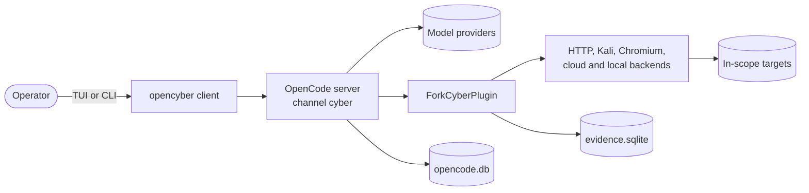
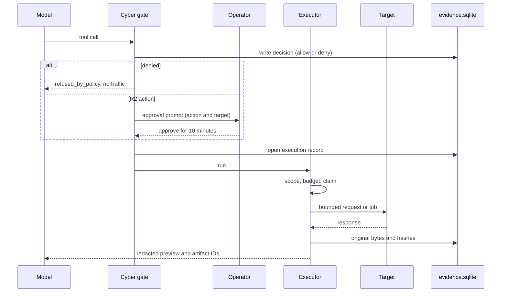

# Architecture

OpenCyber is a fork of OpenCode V2 with a security assessment layer on top. OpenCode provides the engine: sessions, the runner, permissions, compaction, providers and the TUI. The fork adds explicit scope, a risk policy, controlled execution backends, durable evidence and phase agents. The unit of work is an assessment session, not a code project.

It is not an operating system sandbox, it does not prove that a scope is real, and it does not replace human review of a report. It also shares the OpenCode process, server and, by default, session database.

This page describes how the pieces fit. [`FORK.md`](../FORK.md) covers how the fork follows upstream, and the [guides](README.md#guides) cover each module.

## Context

The `opencyber` binary is the client. The engine runs in a local background server (`opencode serve --service` on the `cyber` channel), so tools run in the server and not in the TUI. The server opens SQLite, talks to the model and starts the backends. Evidence stays on the operator's machine.

## Runtime

A normal OpenCode session goes prompt, server, `Session.prompt`, inbox, runner. The model receives the base context, `AGENTS.md`, skills and project instructions, then calls tools through the upstream permission system. Everything lands in `opencode.db` and the TUI follows it over SSE.

A cyber session adds this on top:

- The mode (`development`, `review` or `assessment`) is chosen before the process starts.
- The engagement, its scope and its rules of engagement go into the context.
- The tool catalog is filtered by role and risk ceiling.
- Each call passes the `execute.before` gate, gets a decision, asks for R2 approval if needed, and is captured.
- The backend runs it and produces artifacts, which feed tasks, findings and the report.

### What the fork changes in each layer

| Layer             | Upstream OpenCode V2                                                       | What the fork adds or changes                                                                                                           |
| ----------------- | -------------------------------------------------------------------------- | --------------------------------------------------------------------------------------------------------------------------------------- |
| CLI and TUI       | `packages/cli`, `packages/tui`: entry point, commands, Solid TUI, client   | Wordmark, ` (Cyber)` version, own updater, shared state (F-004), assessment profile launcher, export profiles                           |
| Server            | `packages/server`: HttpApi, auth, SSE, Location middleware                 | Session export handler and transfer contract. The rest is untouched                                                                     |
| Core              | Session runner, agents, tools, permissions, plugins, compaction, MCP       | `ForkCyberPlugin`, process policy, hardened file access, attempt tracing, tool input repair, manual delegation                          |
| Providers         | `packages/ai` protocols and providers                                      | Claude Pro/Max OAuth plugin (F-002)                                                                                                     |
| Data              | `opencode.db`: sessions, messages, credentials, projects, permissions      | Separate `evidence.sqlite`. `opencode.db` is shared with the official install by default                                                |
| Clients           | Web app, desktop, session UI, SDK                                          | Auto-approval and permission model adjustments in `app`. Desktop untouched                                                              |
| Build and release | Bun build, `latest` and `beta` channels, npm                               | `cyber` channel build, GitHub Releases, Windows verification, own installer and updater                                                 |
| CI                | Upstream workflows on hosted and Blacksmith runners (disabled in the fork) | `fork-*` workflows on `ubuntu-latest`: typecheck, tests, Kali, Chromium, code review and surface labs, ledger, release, runner recovery |

Every change to an upstream file is recorded in the [ledger](../FORK.md#7-ledger-of-fork-changes-to-upstream-code), and CI fails when one is missing.

## The cyber layer

The cyber layer is a built-in plugin that hooks into the OpenCode session lifecycle, not a separate service. It reads best as a stack:

| Plane       | What it holds                                                                        |
| ----------- | ------------------------------------------------------------------------------------ |
| Operator    | Authority and configuration that live outside the model: profile, scope, approvals   |
| Integration | Session lifecycle hooks: context, `execute.before`, `execute.after`, compaction      |
| Policy      | Mode, role, risk class, scope and approval                                           |
| Domains     | 31 typed tools grouped by target type, listed in the [tool reference](tools.md)      |
| Backends    | Isolated, bounded execution: HTTP client, Kali jobs, Chromium identities, cloud APIs |
| Evidence    | Artifacts, decisions, tasks, coverage and findings, across all planes                |

The code lives in `packages/core/src/fork-cyber/` (one module per domain) and `packages/core/src/plugin/fork-cyber.ts` (registration and hooks). Tests are in `packages/core/test/plugin/fork-cyber*.test.ts`.

What is stored: the input and output of every non-administrative execution, binary artifacts with hashes, provenance, effective scope, allow and deny decisions, approvals, tasks, coverage and findings.

What is not stored: model reasoning, provider secrets, credential values (only leases), and the internal state of Kali or Chromium.

## What happens in a tool call

The decision happens before execution. A denied call sends no traffic and opens no execution record. An allowed call opens its execution record before touching the target.

The gate checks, in order:

1. Mode: `development`, `review` or `assessment`.
2. Role: can this agent call this tool?
3. Action: is the variant declared with a risk class?
4. Ceiling: do the mode and the phase allow that risk?
5. Declaration: for R2, does the engagement declare the action?
6. Approval: for R2, is there a current operator approval?

Then the executor checks:

1. Scope: the exact host, CIDR, service or resource.
2. Budget: `max_rps`, bytes, connections and duration.
3. Claim: a phase worker needs an active task.

Each decision, allowed or denied, is written to `cyber_decision` before anything else happens. The table is append-only, enforced by a trigger. The model never sees raw credential values. It gets redacted previews of at most 8,000 characters and artifact IDs it can pass to `cyber_artifacts` or `evidence`.

## Policy

### Modes

`development` keeps ordinary OpenCode access and project discovery. `review` allows source and evidence inspection and code review. `assessment` adds scoped HTTP, browser, Kali and surface tools, and delegation under the same policy. Review and assessment also disable target configuration, plugins, MCP servers, agents and instruction discovery before the Location starts, so a reviewed repository cannot load its own extensions. The [audit corrections](design/audit.md#controlled-modes) explain the details.

Modes are policy, not a process sandbox. Approved operator plugins keep the service's OS permissions.

### R2 approval

An R2 action runs only when all of this is true:

- The session is in `assessment` mode.
- The agent's phase ceiling reaches R2.
- The engagement declares the exact action in `rules_of_engagement.validation`.
- The operator approves that action on that target.

The approval lasts ten minutes and there is no "always". It does not prove that the target is a lab (`environment: laboratory` is a manifest attestation), it does not identify the operator cryptographically, and it covers origin plus path without the query string. See the [approval guide](guides/approval.md).

### Roles and ceilings

| Agent               | Ceiling | Main lane                                                          | Can confirm findings          | Notes                                                                  |
| ------------------- | ------- | ------------------------------------------------------------------ | ----------------------------- | ---------------------------------------------------------------------- |
| primary (top-level) | By mode | Full assessment set plus delegation                                | Yes, with validation evidence | Only agent that can propose or change scope. In assessment it proposes |
| `cyber-recon`       | R1      | Observe: read, glob, grep, HTTP GET/HEAD/OPTIONS, `cyber_services` | No                            | Never exploits. No shell, no arbitrary Kali                            |
| `cyber-enum`        | R1      | Services, endpoints and authentication surfaces                    | No                            | Produces candidates for exploitation                                   |
| `cyber-exploit-web` | R2      | HTTP replay, browser, web test                                     | Only with a validation task   | No Kali, no host shell                                                 |
| `cyber-exploit-net` | R2      | Kali, services, surface, directory                                 | Only with a validation task   | No web tools                                                           |
| `cyber-postex`      | none    | None                                                               | No                            | No tools until a lab VM tier with per-action approval exists           |
| `cyber-validate`    | R2      | Validation, local validation, directory                            | Yes, that is its job          | Reproduces from scratch and does not improve the finding               |
| `cyber-code-review` | R0      | Source review, SARIF, artifacts, binary, directory                 | No                            | Never runs project code                                                |
| `cyber-report`      | R0      | Read-only: tasks, coverage, findings, report                       | No                            | Never changes scope, notes, findings or the environment                |

The role lanes are in `packages/core/src/fork-cyber/roles.ts` and the risk table in `packages/core/src/fork-cyber/decision.ts`.

## Data

There are two databases with different owners and lifecycles.

**`opencode.db`** belongs to OpenCode. It holds sessions, messages, events, credentials, projects, permissions and schedules. By default OpenCyber shares it with the official `opencode` install (F-004), so it contains the full transcript of an assessment, including targets and results. Upstream owns its migrations and the fork avoids touching them. Deleting a chat does not delete cyber evidence.

**`evidence.sqlite`** belongs to the harness and lives in `Global.data/opencyber`. It holds engagements, notes, executions, artifacts, findings, tasks, coverage, decisions, approvals, sealed credentials, budgets and attempt traces, at schema version 12. Each artifact has a SHA-256 hash. `cyber_decision` and `cyber_credential_lease` are append-only by trigger. Export and purge are manual and need the server stopped. The [storage guide](guides/storage.md) covers the lifecycle.

### Shared and isolated profiles

| Resource               | Default `opencyber`                                          | Isolated profile (`script/fork-cyber-profile.ts`)   |
| ---------------------- | ------------------------------------------------------------ | --------------------------------------------------- |
| Sessions and logins    | `opencode.db` shared with the official install               | The profile's own database                          |
| Evidence               | `Global.data/opencyber/evidence.sqlite`                      | `<profile>/data/opencode/opencyber/evidence.sqlite` |
| Configuration          | `~/.config/opencode`                                         | `<profile>/config/opencode`                         |
| TUI state              | `latest` channel, shared                                     | The profile's own channel                           |
| Engagement credentials | Sealed in `evidence.sqlite`, key in `Global.state/opencyber` | Key and database inside the profile                 |
| Recommended for        | Development, labs, everyday coding                           | Assessments with client data                        |

Engagement credentials are encrypted with AES-256-GCM, with the owner, label and kind as associated data. The key is kept in the state directory, apart from the database. On POSIX the file mode is forced to 0600. On Windows the profile ACL protects it.

## Known gaps

An architecture review of `custom` on 12 November 2026 found the issues below. It was a static review of the code and documents, not an assessment run or a pentest. None of them have been fixed in code yet. They are ordered by impact.

| ID  | Issue                                                                           | Severity    | Effort |
| --- | ------------------------------------------------------------------------------- | ----------- | ------ |
| H1  | The cyber layer has no activation boundary. It runs in every session            | High        | M      |
| H2  | The default mode is `development`, the most permissive one                      | High        | S      |
| H3  | Assessments share `opencode.db` with the official install by default            | High        | M      |
| H4  | Authorization is split across several lists                                     | Medium-high | M      |
| H5  | `review` and `assessment` are policy, not a process sandbox                     | Medium-high | L      |
| H6  | Evidence is not encrypted, has no retention, and its key lives on the same host | Medium      | L      |
| H7  | The plugin is one large file and some tool schemas are complex                  | Medium      | M      |
| H8  | Budgets are per channel, with no engagement-wide total                          | Medium      | M      |
| H9  | A completed task is not verified coverage                                       | Medium      | M      |
| H10 | The main documents described an older state                                     | Low         | S      |
| H11 | The installer and updater do not verify the release hash or signature           | Medium      | S      |

**H1.** `ForkCyberPlugin` is registered in the built-in list of every Location (`packages/core/src/plugin/internal.ts`). Its context hook adds the operator prompt and the engagement to every session, and `execute.before` archives every non-administrative tool call, including `read`, `grep`, `edit`, `shell` and `subagent`. An ordinary coding session therefore copies file contents and shell output, `.env` files included, into `evidence.sqlite`. The fix is an explicit cyber session (a command, session metadata or `/cyber`) and no context or capture outside it.

**H2.** `ForkCyberPolicy.selected()` falls back to `OPENCYBER_MODE ?? "development"` (`packages/core/src/fork-cyber/policy.ts`), and so does the profile launcher. Development allows the whole catalog, host shell, target discovery and scope writes by the model. The cyber binary should default to `assessment` or `review`, with `development` behind an explicit flag.

**H3.** The `cyber` build sets `OPENCODE_DISABLE_CHANNEL_DB=1` and `OPENCODE_TUI_CHANNEL=latest` (`packages/cli/src/fork-shared-state.ts`). Evidence is separate, but the transcript with targets, internal paths and tokens seen in responses sits next to personal coding sessions. The isolated profile exists but is opt-in. Assessments should use it by default, with an explicit one-time import of provider logins.

**H4.** Mode and role are checked in `policy.ts`, tool sets and ceilings in `roles.ts`, actions and risk in `decision.ts`, capture and claims in `fork-cyber.ts`, HTTP methods in `http.ts`, and `requireClaim` is repeated across modules. `cyber_capabilities` re-implements permission resolution. A forgotten list gives either a bypass or a wrong inventory. One `authorize(tool, input, actor)` with per-tool metadata would remove that class of bug.

**H5.** Hardened modes turn off target plugins, MCP, agents and instructions and block host shell, webfetch and websearch, but approved plugins keep the user's permissions and the process is the same. With a hostile target that carries prompt injection, the boundary is a policy check. For client work, run the assessment under a separate OS user, container or VM.

**H6.** Artifacts are stored as base64 in `evidence.sqlite` and the storage guide states that raw archives are neither redacted nor encrypted. There is no automatic retention and deleting a session does not cascade. A backup of the data directory carries client data and secrets. The plan is encryption at rest, per-engagement retention, the OS keychain for the key, and export and purge from the UI.

**H7.** `fork-cyber.ts` registers all 31 tools in a single generator. `cyber_surface` is a union of modules and actions, and F-025 already had to add input repair so models pick the right discriminator. Splitting registration by domain and flattening `cyber_surface` would make reviews and tool calls easier. Measure the tool-call error rate before adding more tools.

**H8.** HTTP uses `http_budget` and `max_rps`. Kali uses `network_budget` with bytes, connections and duration. `cyber_report` shows no combined total, so the operator has to add them up by hand.

**H9.** `cyber_coverage` lists recorded tasks and their executions, not the whole target, and the tool says so. A reader can still take "completed" as "tested". Separate recorded, tested and verified states, require evidence types per task, and make an "examined and not examined" section mandatory in the report.

**H10.** The toolset document still said 22 tools and described `kali_run` without an allowlist, the plan said `iac_scan` and R2 were not available, and the audit document said Code Mode `execute` was unavailable in hardened modes. This documentation restructure corrected those statements.

**H11.** `script/fork-install.ps1` and `script/fork-install.sh` download and extract the release archive without checking `SHA256SUMS`, which every release publishes, and the binaries are not code-signed. If the GitHub account or a release were compromised, the operator would run arbitrary code on the machine that holds client data. Verify the checksum before extracting and fail closed, sign the Windows binary, and pin the expected hash in `ForkUpdater`.

### Recommended order

The first three issues have the same fix: cyber is explicit, assessments get their own profile, and capture only happens when there is an engagement.

1. **Now.** An explicit cyber session (H1), a hardened default mode (H2), a separate assessment profile (H3), and a permission explanation that reads the real policy. The acceptance test: a normal session contains no operator prompt and adds no rows to `evidence.sqlite`.
2. **Next.** One authorization service (H4) and one engagement budget (H8). Start measuring tool-call error rate and cost per session.
3. **Before client data.** Encrypted evidence with retention (H6) and process or VM isolation (H5). Until then OpenCyber is suitable for labs and your own systems, not for client data with confidentiality requirements.

What should not change: the harness stays inside OpenCode as a plugin. Plugins and hooks reuse sessions, permissions, compaction and models without duplicating the engine, and SQLite already gives the durability a local tool needs. The problems are about boundaries, not the stack.
